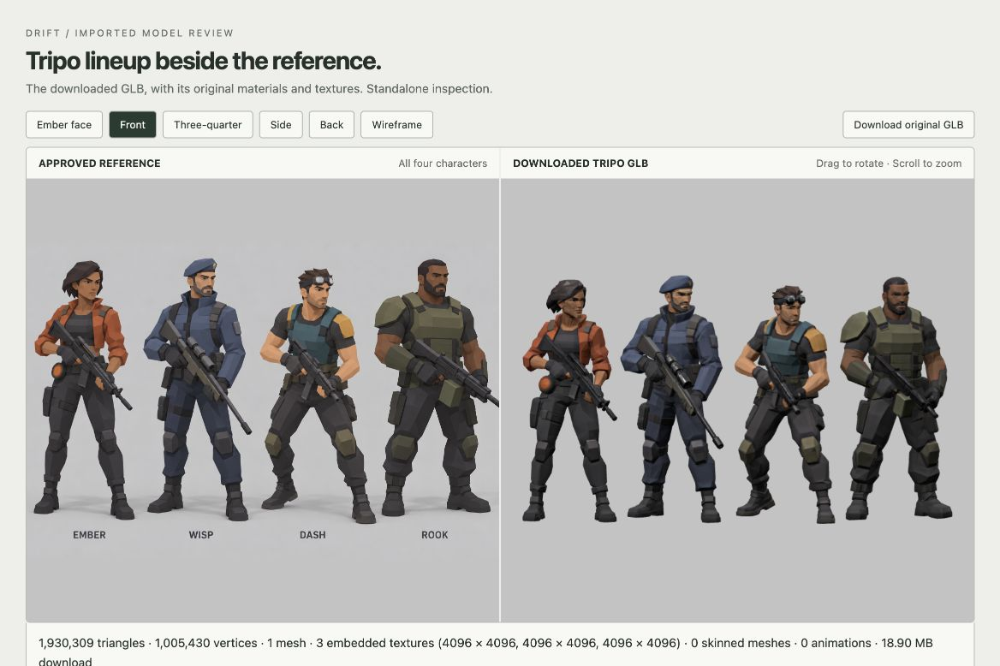
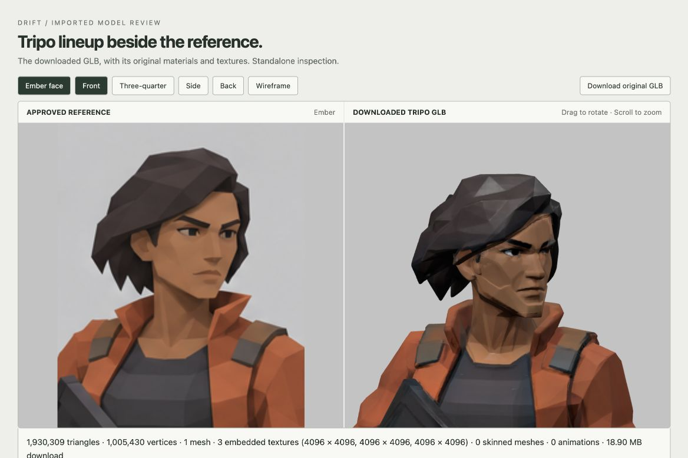

# Tripo character lineup inspection

Downloaded successfully from the user-supplied Tripo URL on 2026-10-01. The signed URL is not stored here. The original downloaded GLB is unchanged.

[Interactive inspection](http://127.0.0.1:5174/tripo-review.html) · [Original GLB](tripo-character-lineup.glb)

## Measured asset data

- 18,902,780 bytes (18.90 MB).
- 1,930,309 triangles and 1,005,430 indexed vertices across all four characters.
- One mesh, one primitive and one material in the GLB scene.
- Four disjoint character components, separable without cutting triangles. Exact component counts after joining duplicate-position UV seam vertices:

| Character | Triangles |
| --- | ---: |
| Ember | 433,694 |
| Wisp | 512,314 |
| Dash | 461,409 |
| Rook | 522,892 |

- Three embedded 4096 × 4096 textures: base color JPEG, metallic/roughness JPEG, normal PNG.
- No skeleton, skinning, morph targets or animation clips. Guns are included in the character geometry and are not separate scene objects.
- Requires `EXT_meshopt_compression` and `KHR_mesh_quantization`. The included Three.js MeshoptDecoder loads it successfully.
- Decoded geometry buffers total 47,294,028 bytes (45.1 MiB). Three RGBA8 textures with full mip chains would use approximately 256 MiB of GPU storage; that is a format-based estimate, not a measured GPU allocation. The maps cover the shared lineup atlas, not each character independently.

The four previous procedural character GLBs together contain 242,094 triangles and total 26.18 MB. This Tripo lineup is smaller on disk but has about eight times the geometry of that whole set. File compression does not remove render-time triangles.

## Visual findings

The outfits, body proportions, equipment and poses closely follow the approved concept overall. Ember's face is still more angular, with a heavier brow and squarer jaw than the illustration. The back views are fully modeled. This is suitable for evaluating a high-detail source asset; it is not yet a low-spec browser-game character set.

Separating the four figures, reducing geometry, reducing/compressing textures, and adding animation rigs are subsequent work. No integration or asset optimization was performed during this inspection.

## Checks performed

- GLB structure and embedded resources inspected.
- Meshopt buffers decoded; no nonfinite positions/UVs, invalid indices, zero normals or zero-area triangles found.
- Four disconnected character components confirmed, with gaps and no bridges between figures.
- Front, rear and Ember close-up rendered in a standalone browser viewer with original PBR textures.

